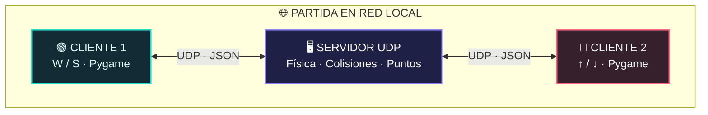

<div align="center">

# 🏓 PONG // NEON

### ⚡ Multijugador en tiempo real · UDP · Multihilo · Pygame

**Un Pong clásico con estilo neón, partidas entre dos computadoras y un servidor que mantiene todo sincronizado.**


**🟢 JUGADOR 1 &nbsp; · &nbsp; ⚪ PELOTA &nbsp; · &nbsp; 🔴 JUGADOR 2**

</div>

---

## ✨ ¿Qué es este proyecto?

**Pong Neon** es un videojuego de dos jugadores desarrollado en **Python y Pygame Community Edition** como práctica de **Sistemas Distribuidos**.

Dos personas pueden jugar desde distintas computadoras mediante **sockets UDP**. El servidor controla la pelota, los rebotes, las raquetas y el marcador; cada cliente dibuja el juego y envía los controles de su jugador.

> 🎯 **Objetivo:** ser el primero en llegar a **7 puntos**. ¡Cada golpe acelera la pelota y aumenta la dificultad!

## 🌌 Características

| 🕹️ Jugabilidad | 🌐 Red y programación |
| :--- | :--- |
| 🎨 Interfaz neón con dos raquetas de colores | 📡 Comunicación **UDP** |
| ✨ Pelota con brillo, estela y partículas | 🖥️ Arquitectura **cliente-servidor** |
| 🏓 Rebotes con ángulo según el golpe | 🧵 Recepción de datos **multihilo** |
| ⚡ Velocidad +5 % por golpe (máx. 900 px/s) | 🔒 Sincronización con `threading.Lock()` |
| 🏆 Marcador y victoria a los 7 puntos | 🔁 Actualización de estados entre clientes |
| ⏸️ Pausa, continuación y reinicio | 📦 Intercambio de mensajes en **JSON** |

## 🧠 ¿Cómo funciona?



**Servidor (`servidor.py`)**: administra los dos jugadores, calcula el movimiento y decide cuándo hay rebotes, puntos o un ganador.

**Cliente (`cliente.py`)**: muestra la interfaz de Pygame, detecta las teclas y se comunica con el servidor.

**Multihilo**: mientras el hilo principal actualiza el juego o dibuja la ventana, un hilo secundario recibe paquetes UDP. Se utiliza un candado (`Lock`) para proteger los datos compartidos.

> ℹ️ UDP es rápido y ligero, pero no garantiza la entrega ni el orden de los paquetes. El proyecto utiliza números de secuencia y reenvía brevemente los comandos importantes para mejorar su funcionamiento.

## 📁 Estructura del proyecto

```text
PyGame/
├── servidor.py      # Lógica del juego y socket UDP
├── cliente.py       # Interfaz, controles y comunicación UDP
├── README.md        # Documentación
└── .gitignore       # Excluye archivos locales
```

La carpeta `.venv/` es local y **no debe subirse a GitHub**.

## 🚀 Instalación

Requisitos: **Python 3** y **pygame-ce** en las computadoras que ejecutan el cliente. El servidor utiliza únicamente módulos de la biblioteca estándar de Python.

**1. Crear un entorno virtual (opcional si PyCharm ya creó `.venv`):**

```powershell
py -m venv .venv
```

**2. Instalar Pygame CE en el entorno virtual (Windows / PowerShell):**

```powershell
.\.venv\Scripts\python.exe -m pip install pygame-ce
```

> ✅ Se utiliza `pygame-ce`, pero el código sigue importando la biblioteca como `import pygame`.

## 🎮 Ejecutar el juego

### 🖥️ Computadora principal: servidor

Abre la primera terminal y ejecuta:

```powershell
.\.venv\Scripts\python.exe servidor.py --bind 0.0.0.0 --puerto 5000
```

`0.0.0.0` significa que el servidor escucha en las interfaces IPv4 de esa computadora. **No** es la IP que debe escribir el otro jugador.

### 🟢 Jugador 1: en la misma computadora del servidor

En una segunda terminal:

```powershell
.\.venv\Scripts\python.exe cliente.py --host 127.0.0.1 --puerto 5000
```

### 🔴 Jugador 2: desde otra computadora

1. En la computadora del servidor, ejecuta `ipconfig` y busca su **dirección IPv4** activa.
2. Confirma que las dos computadoras puedan comunicarse por la red.
3. En la carpeta que contiene `cliente.py`, ejecuta:

```powershell
py -m pip install pygame-ce
py cliente.py --host 192.168.1.50 --puerto 5000
```

**Sustituye `192.168.1.50` por la IP real de la computadora del servidor.** El puerto predeterminado es `5000/UDP`.

> 🔐 En caso de bloqueo, revisa las reglas del firewall para el **puerto UDP 5000** y las restricciones de la red. No es necesario desactivar todo el firewall.

### 🧪 Prueba local con dos clientes

Si todavía no tienes una segunda computadora, abre **dos terminales adicionales** con el mismo comando de cliente:

```powershell
.\.venv\Scripts\python.exe cliente.py --host 127.0.0.1
```

La primera ventana será el Jugador 1 y la segunda el Jugador 2. Para jugar simultáneamente, es más práctico usar dos computadoras.

## ⌨️ Controles

| Acción | Tecla |
| :--- | :---: |
| 🟢 Jugador 1: subir / bajar | `W` / `S` |
| 🔴 Jugador 2: subir / bajar | `↑` / `↓` |
| ⏸️ Pausar partida | `P` |
| ▶️ Continuar | `C` |
| 🔄 Reiniciar partida | `R` |
| 🚪 Salir del cliente | `ESC` |

## 🏆 Reglas de la partida

- La pelota rebota contra el techo, el suelo y las raquetas.
- La dirección del rebote depende de dónde golpea la pelota.
- La rapidez aumenta un **5 % por golpe de raqueta**, hasta un máximo de **900 px/s**.
- Si la pelota supera una raqueta, el rival suma un punto.
- La partida termina cuando un jugador alcanza **7 puntos**.
- Con `R` se reinician el marcador y la partida.

## 🛠️ Tecnologías utilizadas

- **Python:** lógica y ejecución del proyecto.
- **Pygame CE:** gráficos, teclado y ventana.
- **`socket`:** envío y recepción de datagramas UDP.
- **`threading`:** tareas simultáneas de juego y comunicación.
- **JSON:** formato de los mensajes transmitidos entre computadoras.

## 📚 ¿Qué aprendimos?

Este proyecto demuestra cómo utilizar sockets, separar responsabilidades entre cliente y servidor, sincronizar el estado de un juego y procesar mensajes de red mientras la aplicación continúa funcionando.

Fue desarrollado como una **práctica académica de Sistemas Distribuidos** y está pensado para comprender los fundamentos de una aplicación multijugador en una red local.

---

<div align="center">

### 💠 KEEP PLAYING · KEEP CODING 💠

**`PYTHON` · `PYGAME` · `UDP` · `THREADING`**

*Proyecto académico · Pong Neon*

</div>
