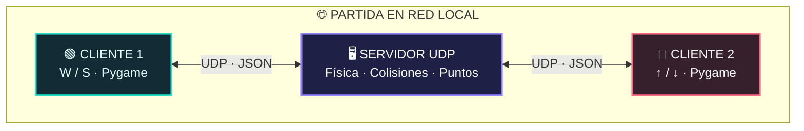
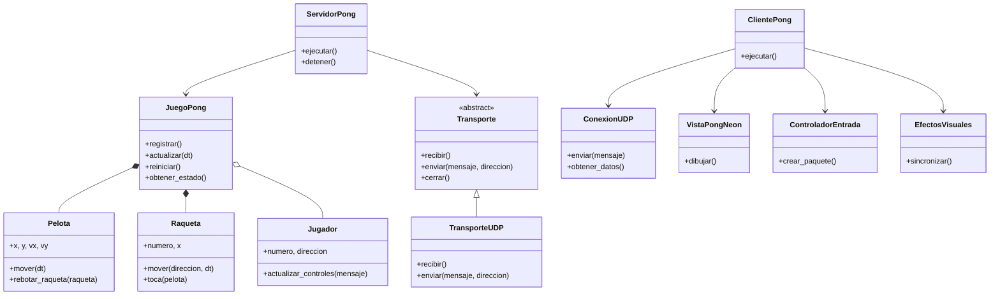

<div align="center">

# 🏓 PONG // NEON

### ⚡ Multijugador en tiempo real · UDP · Multihilo · Pygame

**Un Pong clásico con estilo neón, partidas entre dos computadoras y un servidor que mantiene todo sincronizado.**


**🟢 JUGADOR 1 &nbsp; · &nbsp; ⚪ PELOTA &nbsp; · &nbsp; 🔴 JUGADOR 2**

**Proyecto académico en equipo · Alejandro Ojeda & Christian Carrion**

</div>

---

## ✨ ¿Qué es este proyecto?

**Pong Neon** es un videojuego de dos jugadores desarrollado en **Python y Pygame Community Edition** como práctica de **Sistemas Distribuidos**.

Dos personas pueden jugar desde distintas computadoras mediante **sockets UDP**. El servidor controla la pelota, los rebotes, las raquetas y el marcador; cada cliente dibuja el juego y envía los controles de su jugador.

> 🎯 **Objetivo:** ser el primero en llegar a **7 puntos**. ¡Cada golpe acelera la pelota y aumenta la dificultad!

## 👥 Equipo de desarrollo

Este proyecto fue realizado de manera conjunta por **Alejandro Ojeda** y **Christian Carrion**, como actividad de **Sistemas Distribuidos** en la **Universidad Politécnica Salesiana**.

El trabajo en equipo abarca el desarrollo y revisión del juego, la comunicación cliente-servidor, la incorporación de clases y objetos, y las pruebas de funcionamiento. La distribución específica de tareas no se detalla aquí para evitar atribuir actividades sin un registro de responsabilidades.

## 🆕 Actualización: de código procedural a POO y SOLID

Se mantuvo la funcionalidad original del Pong y se reorganizó el proyecto para que cada elemento tenga su propia **clase**, **constructor** (`__init__`) y **métodos**.

| Antes | Después |
| :--- | :--- |
| Posición y movimiento de la pelota dentro de un bloque general | Clase `Pelota` con `mover()`, `rebotar_pared()` y `rebotar_raqueta()` |
| Raquetas y colisiones mezcladas con las reglas | Clase `Raqueta` con `mover()`, `toca()` y `impacto_relativo()` |
| Puntuación y estados directamente en el bucle | Clase `JuegoPong` para turnos, puntos, ganador y reinicio |
| Código UDP acoplado a la lógica | Contrato `Transporte` e implementación `TransporteUDP` |
| Controles y gráficos en un solo bloque | `ControladorEntrada`, `VistaPongNeon` y `EfectosVisuales` |
| Pruebas manuales principalmente | `unittest` y prueba local de dos clientes UDP |

**Lo que no cambia:** sockets UDP, comunicación entre Windows y Ubuntu cuando la red lo permite, interfaz neón, dos jugadores, `W/S`, flechas, `P/C/R`, juego a 7 puntos y velocidad que aumenta 5 % por golpe (hasta 900 px/s). La cancha se escala visualmente para que la barra inferior no oculte la pelota.

## 🌌 Características

| 🕹️ Jugabilidad | 🌐 Red y programación |
| :--- | :--- |
| 🎨 Interfaz neón con dos raquetas de colores | 📡 Comunicación **UDP** |
| ✨ Pelota con brillo, estela y partículas | 🖥️ Arquitectura **cliente-servidor** |
| 🏓 Rebotes con ángulo según el golpe | 🧵 Recepción de datos **multihilo** |
| ⚡ Velocidad +5 % por golpe (máx. 900 px/s) | 🔒 Sincronización con `threading.Lock()` |
| 🏆 Marcador y victoria a los 7 puntos | 🔁 Actualización de estados entre clientes |
| ⏸️ Pausa, continuación y reinicio | 📦 Intercambio de mensajes en **JSON** |

## 🧠 ¿Cómo funciona?



**Servidor (`servidor.py`)**: administra los dos jugadores, calcula el movimiento y decide cuándo hay rebotes, puntos o un ganador.

**Cliente (`cliente.py`)**: muestra la interfaz de Pygame, detecta las teclas y se comunica con el servidor.

**Multihilo**: mientras el hilo principal actualiza el juego o dibuja la ventana, un hilo secundario recibe paquetes UDP. Se utiliza un candado (`Lock`) para proteger los datos compartidos.

> ℹ️ UDP es rápido y ligero, pero no garantiza la entrega ni el orden de los paquetes. El proyecto utiliza números de secuencia y reenvía brevemente los comandos importantes para mejorar su funcionamiento.

## 🧱 Arquitectura orientada a objetos (POO)

El proyecto ahora está desarrollado con **clases, objetos, constructores `__init__`, métodos y encapsulamiento**. Se separó el modelo (física y jugadores), el controlador (reglas y entradas), la vista (Pygame) y la red (UDP).

### Clases del servidor

| Clase | Constructor / datos | Métodos importantes |
| :--- | :--- | :--- |
| `ConfiguracionJuego` | `ancho`, `alto`, `meta`, `aceleracion`... | Configuración inmutable mediante `@dataclass(frozen=True)` |
| `Pelota` | `__init__(config)` | `mover()`, `rebotar_pared()`, `rebotar_raqueta()`, `reiniciar()` |
| `Raqueta` | `__init__(numero, x, y, config)` | `mover()`, `toca()`, `impacto_relativo()`, `reiniciar()` |
| `Jugador` | `__init__(numero, direccion)` | `actualizar_controles()`, `direccion_movimiento()`, `desconectado()` |
| `JuegoPong` | `__init__(config)` | `registrar()`, `procesar_paquete()`, `actualizar()`, `reiniciar()`, `obtener_estado()` |
| `Transporte` | Interfaz abstracta `ABC` | `recibir()`, `enviar()`, `cerrar()` |
| `TransporteUDP` | `__init__(ip, puerto)` | Implementa los métodos de `Transporte` con `socket.SOCK_DGRAM` |
| `ServidorPong` | `__init__(juego, transporte)` | `ejecutar()`, `detener()`, `_recibir_mensajes()` |

### Clases del cliente

| Clase | Constructor / datos | Métodos importantes |
| :--- | :--- | :--- |
| `ConfiguracionVisual` | `__init__()` | Colores, dimensiones y barra inferior |
| `ConexionUDP` | `__init__(host, puerto)` | `enviar()`, `_recibir()`, `obtener_datos()`, `cerrar()` |
| `ControladorEntrada` | `__init__()` | `procesar_evento()`, `crear_paquete()` |
| `EfectosVisuales` | `__init__()` | `sincronizar()`, `dibujar_particulas()`, `limpiar()` |
| `VistaPongNeon` | `__init__(config)` | `dibujar()`, `esperar_fotograma()`, `cerrar()` |
| `ClientePong` | `__init__(host, puerto)` | `ejecutar()` |

### Relaciones entre objetos



### ♻️ Aplicación de los principios SOLID

| Principio | Ejemplo concreto |
| :--- | :--- |
| **S — Responsabilidad única** | `Pelota` resuelve rebotes; `VistaPongNeon` dibuja; `ConexionUDP` comunica |
| **O — Abierto/cerrado** | Se pueden crear nuevas implementaciones de `Transporte` sin reescribir `ServidorPong` |
| **L — Sustitución de Liskov** | `ServidorPong` acepta cualquier implementación válida de `Transporte`; la prueba usa un transporte falso |
| **I — Segregación de interfaces** | `Transporte` expone solo tres operaciones pequeñas: recibir, enviar y cerrar |
| **D — Inversión de dependencias** | `ServidorPong` recibe `Transporte` por constructor en vez de instanciar `TransporteUDP` dentro |

> En Python, las variables que comienzan con `_` indican atributos o métodos internos por convención. En las entidades se accede a propiedades como `raqueta.y` mediante `@property`.

---

## 📁 Estructura del proyecto

```text
PyGame/
├── servidor.py      # Lógica del juego y socket UDP
├── cliente.py       # Interfaz, controles y comunicación UDP
├── README.md        # Documentación de POO y SOLID
├── INFORME_PONG_NEON_ALEJANDRO_CHRISTIAN.docx # Informe conjunto
├── GUIA_DEFENSA.md  # Explicación de las clases y preguntas
├── requirements.txt # Dependencia gráfica
├── tests/           # Pruebas de física y UDP
└── .gitignore       # Excluye archivos locales
```

La carpeta `.venv/` es local y **no debe subirse a GitHub**.

## 🚀 Instalación

Requisitos: **Python 3** y **pygame-ce** en las computadoras que ejecutan el cliente. Código orientado a **Python 3.10 o superior**. El servidor utiliza únicamente módulos de la biblioteca estándar de Python.

**1. Crear un entorno virtual (opcional si PyCharm ya creó `.venv`):**

```powershell
py -m venv .venv
```

**2. Instalar Pygame CE en el entorno virtual (Windows / PowerShell):**

```powershell
.\.venv\Scripts\python.exe -m pip install pygame-ce
```

> ✅ Se utiliza `pygame-ce`, pero el código sigue importando la biblioteca como `import pygame`.

## 🎮 Ejecutar el juego

### 🖥️ Computadora principal: servidor

Abre la primera terminal y ejecuta:

```powershell
.\.venv\Scripts\python.exe servidor.py --bind 0.0.0.0 --puerto 5000
```

`0.0.0.0` significa que el servidor escucha en las interfaces IPv4 de esa computadora. **No** es la IP que debe escribir el otro jugador.

### 🟢 Jugador 1: en la misma computadora del servidor

En una segunda terminal:

```powershell
.\.venv\Scripts\python.exe cliente.py --host 127.0.0.1 --puerto 5000
```

### 🔴 Jugador 2: desde otra computadora

1. En la computadora del servidor, ejecuta `ipconfig` y busca la **IPv4 del adaptador Ethernet** (es la conexión utilizada en este proyecto).
2. Confirma que las dos computadoras puedan comunicarse por la red.
3. En la carpeta que contiene `cliente.py`, ejecuta:

```powershell
py -m pip install pygame-ce
py cliente.py --host 192.168.1.50 --puerto 5000
```

**Sustituye `192.168.1.50` por la IPv4 Ethernet actual de la computadora del servidor.** El puerto predeterminado es `5000/UDP`.

> 🔐 En caso de bloqueo, revisa las reglas del firewall para el **puerto UDP 5000** y las restricciones de la red. No es necesario desactivar todo el firewall.

### 🐧 Cliente en Ubuntu

Copia `cliente.py` e instala la dependencia en el entorno Python de Ubuntu:

```bash
python3 -m venv .venv
source .venv/bin/activate
python -m pip install pygame-ce
python cliente.py --host IP_ETHERNET_DEL_SERVIDOR --puerto 5000
```

Si la red universitaria separa las laptops, puede ser necesario revisar rutas o reglas del firewall. La IP se obtiene en Windows con `ipconfig`, usando el adaptador **Ethernet**.

### 🧪 Prueba local con dos clientes

Si todavía no tienes una segunda computadora, abre **dos terminales adicionales** con el mismo comando de cliente:

```powershell
.\.venv\Scripts\python.exe cliente.py --host 127.0.0.1
```

La primera ventana será el Jugador 1 y la segunda el Jugador 2. Para jugar simultáneamente, es más práctico usar dos computadoras.

## ⌨️ Controles

| Acción | Tecla |
| :--- | :---: |
| 🟢 Jugador 1: subir / bajar | `W` / `S` |
| 🔴 Jugador 2: subir / bajar | `↑` / `↓` |
| ⏸️ Pausar partida | `P` |
| ▶️ Continuar | `C` |
| 🔄 Reiniciar partida | `R` |
| 🚪 Salir del cliente | `ESC` |

## 🏆 Reglas de la partida

- La pelota rebota contra el techo, el suelo y las raquetas.
- La dirección del rebote depende de dónde golpea la pelota.
- La rapidez aumenta un **5 % por golpe de raqueta**, hasta un máximo de **900 px/s**.
- Si la pelota supera una raqueta, el rival suma un punto.
- La partida termina cuando un jugador alcanza **7 puntos**.
- Con `R` se reinician el marcador y la partida.

## ✅ Pruebas del proyecto

Sin abrir Pygame, ejecuta estas comprobaciones desde la carpeta del proyecto:

```powershell
python -m unittest discover -s tests -p "test_*.py" -v
python tests/prueba_udp.py
```

Resultados de la verificación local del **21 de octubre de 2026**:

- ✅ **6/6 pruebas unitarias aprobadas** (`unittest`): límites de la raqueta, techo, aceleración, ganador/reinicio, secuencias UDP y transporte intercambiable.
- ✅ **Prueba UDP local aprobada** (`tests/prueba_udp.py`): registro de dos jugadores, controles, pausa, continuación, reinicio y sincronización.
- ℹ️ Estas pruebas automatizadas se realizaron localmente; al actualizar los archivos, conviene repetir la prueba práctica entre Windows y Ubuntu en la red de la clase.


## 🛠️ Tecnologías utilizadas

- **Python:** lógica y ejecución del proyecto.
- **Pygame CE:** gráficos, teclado y ventana.
- **`socket`:** envío y recepción de datagramas UDP.
- **`threading`:** tareas simultáneas de juego y comunicación.
- **JSON:** formato de los mensajes transmitidos entre computadoras.

## 📚 ¿Qué aprendimos?

Este proyecto demuestra cómo utilizar sockets, separar responsabilidades entre cliente y servidor, sincronizar el estado de un juego y procesar mensajes de red mientras la aplicación continúa funcionando.

Fue desarrollado **en equipo por Alejandro Ojeda y Christian Carrion** como una **práctica académica de Sistemas Distribuidos** y está pensado para comprender los fundamentos de una aplicación multijugador en una red local.

---

<div align="center">

### 💠 KEEP PLAYING · KEEP CODING 💠

**`PYTHON` · `PYGAME` · `UDP` · `THREADING`**

*Universidad Politécnica Salesiana · Alejandro Ojeda × Christian Carrion · Octubre 2026*

</div>
